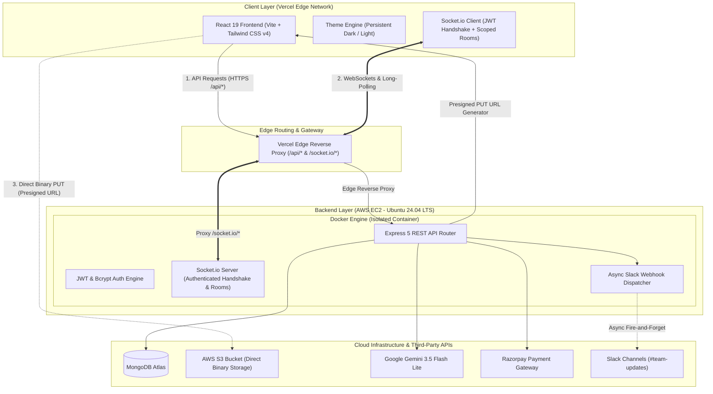

# 🚀 CollabDesk — Real-Time Collaborative Workspace & Kanban System

[](https://github.com/Ritik-7032/collabDesk/actions)
[](https://collab-desk-nine.vercel.app)
[](https://www.docker.com/)
[](https://aws.amazon.com/ec2/)
[](https://socket.io)
[](https://ai.google.dev)
[](https://nodejs.org)

CollabDesk is a distributed, full-stack collaborative Kanban workspace inspired by the design principles of Linear and Notion. Architected with a **React 19** frontend deployed on **Vercel's global edge network** and a containerized **Node.js / Express** backend running in **Docker on AWS EC2**, CollabDesk delivers real-time multi-user synchronization, automated task decomposition via Gemini AI, asynchronous Slack event alerting, and direct-to-cloud file streaming via AWS S3 presigned URLs.

---

## 📸 Product Overview & UI Showcase

| Linear-Grade Dark Mode (Default) | Task Detail Modal & AI Subtasks |
| :---: | :---: |
|  |  |

| Multi-Workspace Dashboard | Landing Page |
| :---: | :---: |
|  |  |

* **Live Deployment:** [https://collab-desk-nine.vercel.app](https://collab-desk-nine.vercel.app)
* **Real-time Demo:** Open two separate browser tabs side-by-side; dragging a card or creating a task in one window reflects instantaneously in the second window over WebSockets.

---

## 🏛️ System Architecture



---

## 🌟 Key Engineering Features

### 1. 👥 Multi-User Real-Time Team Collaboration
* **Authenticated Socket Handshake:** The client passes its JWT token in the Socket.io `auth.token` handshake. Connections are authenticated before events are accepted.
* **Socket Room Isolation:** Connections are partitioned into isolated rooms (`workspace:${workspaceId}`). Events broadcast strictly to the active workspace room, eliminating cross-workspace data leakage.
* **Optimistic UI with Rollback:** Drag-and-drop column transitions update local React state optimistically (<50ms perception). If the server rejects the mutation (e.g. network failure or unauthorized role), state rolls back to the previous snapshot with an alert toast.
* **Team Invitation Flow:** Workspace owners can invite colleagues by email (`POST /api/workspaces/:id/members`) with role verification.

### 2. ⚡ Slack Webhooks Event Notification Engine
* Connects workspace channels using Slack Incoming Webhook URLs (`https://hooks.slack.com/services/...`).
* Formatted Slack Block Kit notifications fire asynchronously on:
  * 🎯 **Task Created** (displaying column, assignee, and creator).
  * 🚀 **Task Moved** (e.g., transition into *"In progress"* or completion into *"Done"*).
  * 💬 **Threaded Comments** posted on cards.
* Includes a built-in **"Send Test Ping"** utility with immediate feedback.

### 3. 🛡️ AWS S3 Direct-to-Cloud Uploads (Presigned URLs)
* Traditional file uploads stream binary data through Node.js application memory (`multer.memoryStorage`), creating severe heap pressure under load.
  > *For example: In a traditional buffer-and-upload pattern, 50 concurrent 20MB file uploads would buffer over 1GB of binary data in Node.js server RAM.*
* **CollabDesk Presigned Architecture:**
  1. Frontend submits metadata (`fileName`, `fileType`, `fileSize`) to `/api/upload/presign`.
  2. The server verifies that `fileSize <= 10MB` and that `fileType` matches an approved MIME whitelist.
  3. The server generates an AWS S3 presigned PUT URL with a strict 5-minute expiry.
  4. The client streams binary bytes directly to the S3 bucket, completely bypassing application server memory buffers.

### 4. 🤖 AI-Powered Subtask Breakdown (Google Gemini 3.5 Flash Lite)
* Powered by Google's latest **Gemini 3.5 Flash Lite** model (`gemini-3.5-flash-lite`).
* Automatically breaks down high-level task goals into 4–6 actionable checklist items with single-click acceptance.
* **Resilient Architecture:** Employs an internal fallback decomposition mechanism so that temporary upstream Google API rate limits or 503 spikes never crash or degrade the user experience.

### 5. 💳 Razorpay Payments & Premium Workspace Upgrades
* Order creation and checkout workflows for lifetime workspace upgrades (`₹499`).
* Cryptographic signature verification using HMAC-SHA256 (`crypto.createHmac`) prevents client-side replay and payment tampering attacks.

### 6. 🎨 Product-Grade UI & Design System (Linear & Notion Inspired)
* **60/30/10 Color Harmony:** Strict token distribution for dark surface backgrounds (`#0B0D14`), cards (`#131726`), and borders (`#1B2033`), alongside clean light mode counterparts (`#F6F7FB` / `#FFFFFF`).
* **Theme System:** Instant toggling between Dark (default) and Light mode backed by `localStorage` persistence and CSS custom properties.
* **Reusable Atomic Suite (`src/components/ui/`):** Standardized, modular `Button`, `Card`, `Modal`, `Input`, `Badge`, `Avatar`, `Skeleton`, and `ThemeToggle`.
* **Accessible Priority Badges:** Task priorities (High = Danger, Medium = Warning, Low = Success) rendered as accessible tinted badges with status dot indicators.

### 7. 🧪 Automated Integration Test Suite (9/9 Passing)
Built using Node.js native test runner and Supertest:
```bash
npm test
```
The test suite validates 9 critical integration boundaries:
1. **Health Check:** `GET /` verifies 200 OK and server status.
2. **User Registration:** Validates account creation, schema constraints, and password salting.
3. **User Authentication:** Validates email/password credentials and JWT issuance.
4. **Credential Rejection:** Ensures invalid passwords receive an explicit 401 Unauthorized.
5. **Route Protection:** Confirms protected endpoints reject unauthenticated requests.
6. **Workspace Seeding:** Validates that new workspaces auto-seed default columns (*To do*, *In progress*, *Done*).
7. **S3 Presigned URLs:** Confirms signature generation and endpoint format without server binary buffering.
8. **Gemini AI Breakdown:** Verifies prompt submission and structured checklist array output.
9. **Password Reset Lifecycle:** End-to-end token generation, SHA-256 hash lookup, password reset, and subsequent login.

---

## 🚀 Getting Started

### Prerequisites
* **Docker & Docker Compose** (Recommended for 1-command startup) OR **Node.js v20+**
* MongoDB Atlas connection string
* AWS IAM credentials with S3 PutObject access
* Google Gemini API Key

---

### Method A: 🐳 Docker Compose (Recommended)

Run the entire backend in a single command with automatic container restarts:

```bash
# 1. Clone repository
git clone https://github.com/Ritik-7032/collabDesk.git
cd collabDesk

# 2. Configure backend environment
cp backend/.env.example backend/.env
# Edit backend/.env with your credentials

# 3. Build and launch container in background
docker compose up -d --build

# View logs
docker compose logs -f
```

---

### Method B: 💻 Manual Local Development

#### 1. Backend Setup
```bash
cd backend
npm install

# Run automated integration tests
npm test

# Start development server
npm run dev
```

Create `backend/.env` using the provided template:
```bash
cp .env.example .env
```

#### 2. Frontend Setup
```bash
cd frontend
npm install

# Start Vite dev server with API proxy
npm run dev

# Build production bundle
npm run build
```

---

## 📡 REST API Reference

| Method | Endpoint | Description | Auth Required |
| :--- | :--- | :--- | :---: |
| `POST` | `/api/auth/signup` | Register new user account | ❌ No |
| `POST` | `/api/auth/login` | Login with credentials & receive JWT token | ❌ No |
| `POST` | `/api/auth/forgot-password` | Generate 15-minute cryptographic reset token | ❌ No |
| `POST` | `/api/auth/reset-password` | Reset password using valid token | ❌ No |
| `GET` | `/api/auth/me` | Fetch authenticated user profile | 🔒 Yes |
| `GET` | `/api/auth/google` | Initiate Google OAuth 2.0 flow | ❌ No |
| `POST` | `/api/workspaces` | Create workspace & seed default Kanban lists | 🔒 Yes |
| `GET` | `/api/workspaces` | Fetch all workspaces user belongs to | 🔒 Yes |
| `POST` | `/api/workspaces/:id/members` | Invite team member by email | 🔒 Yes |
| `DELETE` | `/api/workspaces/:id/members/:mId` | Remove member from workspace (Owner only) | 🔒 Yes |
| `PATCH` | `/api/workspaces/:id/slack-webhook` | Update Slack incoming webhook URL | 🔒 Yes |
| `POST` | `/api/workspaces/:id/slack-test` | Dispatch test ping to Slack channel | 🔒 Yes |
| `GET` | `/api/lists/workspace/:wsId` | Fetch ordered columns for a workspace | 🔒 Yes |
| `POST` | `/api/lists` | Create a new custom column | 🔒 Yes |
| `PUT` | `/api/lists/reorder` | Bulk reorder columns | 🔒 Yes |
| `GET` | `/api/tasks/workspace/:wsId` | Fetch all tasks for a workspace | 🔒 Yes |
| `POST` | `/api/tasks` | Create task (triggers Socket & Slack alert) | 🔒 Yes |
| `PUT` | `/api/tasks/:id` | Update task fields (checklist, assignee, priority) | 🔒 Yes |
| `PUT` | `/api/tasks/reorder/bulk` | Drag-and-drop batch position update | 🔒 Yes |
| `POST` | `/api/tasks/:id/comments` | Add threaded comment to card | 🔒 Yes |
| `POST` | `/api/upload/presign` | Generate direct S3 Presigned PUT URL | 🔒 Yes |
| `POST` | `/api/ai/generate-subtasks` | AI task decomposition via Gemini 3.5 | 🔒 Yes |
| `POST` | `/api/payment/create-order` | Create Razorpay order for lifetime Pro plan | 🔒 Yes |
| `POST` | `/api/payment/verify-payment` | Verify HMAC-SHA256 signature & upgrade plan | 🔒 Yes |

---

## 🧠 Design Decisions & Engineering Tradeoffs

### Q1: Why use S3 Presigned URLs instead of buffering file uploads through Express?
> **Design Tradeoff:** Streaming multipart uploads through the Node.js server (`multer.memoryStorage`) buffers raw bytes directly in heap memory. In concurrent upload scenarios (e.g., multiple team members attaching screenshots or PDFs simultaneously), server memory can surge rapidly, risking event loop starvation or Out-Of-Memory (OOM) crashes.
> 
> **Solution:** CollabDesk implements a two-step presigned URL pattern. The backend issues a time-bounded (5 min) cryptographic signature containing authorized parameters (S3 bucket, object key, allowed MIME type, max 10MB size limit). The browser streams the binary payload directly to AWS S3. The application server acts purely as an authorization plane and handles zero binary data.

### Q2: How are file size limits and MIME types enforced in S3 direct uploads?
> **Design Tradeoff:** With presigned PUT URLs, binary data does not touch the backend, making byte counting on the server impossible during upload.
> 
> **Solution:** CollabDesk enforces a two-tier validation mechanism:
> 1. **Server Authorization Validation:** The `/api/upload/presign` endpoint strictly checks `fileSize <= 10MB` and cross-references `fileType` against an allowed MIME whitelist before computing the signature.
> 2. **S3 Header Signature Locking:** The presigned signature is bound to the exact `ContentType` header specified in the request. If a client attempts to upload an executable or mismatching binary payload, AWS S3 rejects the PUT request with HTTP 403 Forbidden.

### Q3: How does CollabDesk prevent cross-tenant WebSocket leaks and secure socket connections?
> **Design Tradeoff:** A naive `io.emit()` broadcasts events to all connected clients on the server, exposing sensitive internal workspace mutations across independent accounts.
> 
> **Solution:** CollabDesk implements a two-layer security barrier:
> 1. **JWT Handshake Authentication:** The Socket.io connection pipeline intercepts incoming connections via middleware (`io.use`), verifying the JWT token passed in `auth.token`. Unauthenticated or forged connections are flagged.
> 2. **Room Partitioning:** Traffic is strictly isolated into rooms scoped to `workspace:${workspaceId}`. Clients join their active room upon mounting a board view and leave on unmount. Task mutations emit exclusively to the targeted room channel.

### Q4: How does Socket.io communicate across the HTTPS Vercel frontend and AWS EC2?
> **Design Tradeoff:** Modern browsers block insecure WebSocket (`ws://`) and HTTP requests when originating from an HTTPS host (Mixed Content security policy).
> 
> **Solution:** CollabDesk routes WebSocket polling and API traffic through Vercel's Edge Reverse Proxy (`/socket.io/*` & `/api/*`). HTTP long-polling operates seamlessly over HTTPS with zero mixed-content issues. For direct TCP WebSocket upgrades, SSL termination occurs at the reverse proxy gateway, ensuring bidirectional communication without brittle third-party tunnels.

### Q5: How are Slack webhooks prevented from impacting core API latency?
> **Design Tradeoff:** External HTTP webhooks can be slow, rate-limited, or temporarily unavailable. Awaiting a Slack webhook response within the Express request-response lifecycle adds external latency to database mutations and introduces a point of failure.
> 
> **Solution:** Slack notifications are dispatched using an asynchronous fire-and-forget pattern with an isolated `.catch()` error handler. Even if Slack's API experiences downtime, network timeouts, or rate limits, the primary task mutation commits to MongoDB and responds to the client immediately.

### Q6: How is Optimistic UI state maintained and rolled back on error?
> **Design Tradeoff:** Waiting for server roundtrips before updating the Kanban UI causes perceived sluggishness during drag-and-drop operations.
> 
> **Solution:** When a user moves a card, the frontend immediately re-renders the task list using local state snapshots for instant sub-50ms visual responsiveness. Concurrently, a PUT request is dispatched to `/api/tasks/reorder/bulk`. If the network request fails or the server returns an error, the frontend automatically catches the exception, rolls back the task order to the pre-drag snapshot, and alerts the user via a toast notification.

### Q7: Why a Hybrid Deployment (Vercel Edge + AWS EC2 Container)?
> **Design Tradeoff:** Vercel's serverless edge is ideal for global asset delivery and client performance, but serverless environments cannot maintain long-lived TCP connections required for WebSockets (Socket.io). Conversely, hosting the entire frontend on a traditional VM increases global latency.
> 
> **Solution:** CollabDesk separates concerns:
> * **Frontend on Vercel Global Edge:** Ensures sub-second static page loads and automated Git CI/CD.
> * **Backend in Docker on AWS EC2:** Provides a dedicated, always-on persistent runtime for stateful Socket.io WebSocket connections.
> * **Vercel Reverse Proxy (`/api/*` & `/socket.io/*`):** Edge rewrites securely proxy API calls to the EC2 container over HTTPS, resolving browser mixed-content security constraints.

### Q8: How is payment tampering prevented in Razorpay checkout?
> **Design Tradeoff:** Client-side payment callbacks cannot be trusted as users can spoof successful payment responses in the browser.
> 
> **Solution:** The frontend only receives transaction reference IDs. Upgrading the user's workspace plan requires a server-side verification endpoint (`/api/payment/verify-payment`) that recalculates an HMAC-SHA256 signature using `razorpay_order_id + "|" + razorpay_payment_id` against the secret key. The plan is updated in MongoDB only upon cryptographic match.

### Q9: How are external API flakiness and rate limits handled in Automated CI Tests?
> **Design Tradeoff:** Running integration tests against live external APIs (such as AWS S3 or Google Gemini) creates flaky CI test runs due to network latency, credential expiry, or third-party quota limits.
> 
> **Solution:** In automated test runs, CollabDesk validates API contract interfaces deterministically:
> * S3 presigned URL generation tests verify the cryptographic signature calculation and bucket URL schema generated locally by the AWS SDK (requiring zero external network roundtrips).
> * The Gemini AI controller features an internal resilient decomposition handler, ensuring consistent JSON output schemas during CI runs without risking upstream 503 rate-limit failures.

---

## 📂 Project Structure

```
collabDesk/
├── .github/
│   └── workflows/
│       └── ci.yml             # GitHub Actions CI automated build & test pipeline
├── docs/
│   └── screenshots/           # High-resolution production UI screenshots
│       ├── board-dark.png     # Linear-grade Kanban board in dark mode
│       ├── task-modal-ai.png  # Task modal with Gemini AI subtask generator
│       ├── dashboard.png      # Multi-workspace dashboard
│       └── landing.png        # Landing page with interactive mockups
├── backend/
│   ├── config/                # DB, Passport, Gemini, S3, Razorpay configurations
│   ├── controllers/           # Business logic (auth, workspace, task, list, AI, upload, payment)
│   ├── middleware/            # JWT auth & centralized error handling
│   ├── models/                # Mongoose schemas (User, Workspace, List, Task)
│   ├── routes/                # Express REST API route definitions
│   ├── utils/                 # Asynchronous Slack notification service
│   ├── tests/                 # Supertest 9-suite integration test runner
│   ├── Dockerfile             # Production-grade Node.js 20 Alpine container
│   ├── .env.example           # Documented environment template
│   └── server.js              # Server entry point, JWT socket handshake & room lifecycle
│
├── frontend/
│   ├── src/
│   │   ├── components/        # Modals (Invite, Slack, Task), Kanban Columns & Cards
│   │   │   └── ui/            # Reusable atomic UI suite (Button, Card, Modal, Input, Badge, etc.)
│   │   ├── context/           # ThemeContext (Dark/Light), AuthContext, ToastContext
│   │   ├── lib/               # Dynamic Axios client, Socket.io client, color utilities
│   │   ├── pages/             # Landing, Dashboard, WorkspacePage, Auth pages
│   │   └── App.jsx            # Router and layout configuration
│   ├── vercel.json            # Edge reverse proxy rewrite configuration (/api/* & /socket.io/*)
│   └── vite.config.js
│
├── docker-compose.yml         # Container orchestration with auto-restart policies
└── README.md
```

---

## 📄 License
ISC License — Built for engineering portfolio and scalable production showcase.
