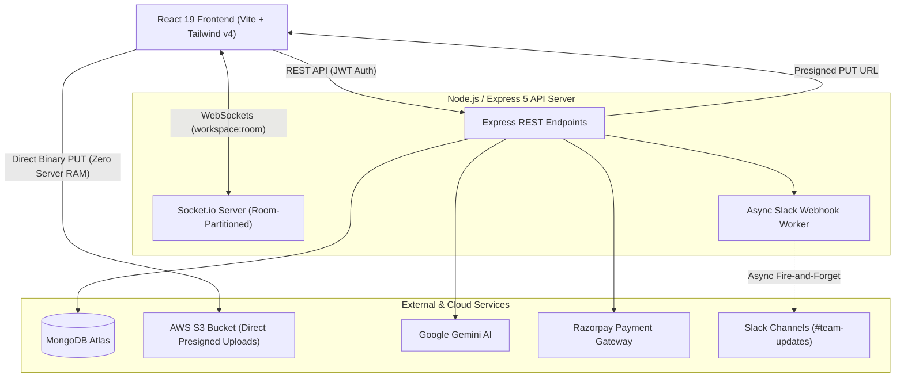

# 🚀 CollabDesk — Real-Time Collaborative Workspace & Kanban System

[](https://nodejs.org)
[](https://react.dev)
[](https://socket.io)
[](https://aws.amazon.com/s3)
[](https://ai.google.dev)
[](https://api.slack.com)
[](https://nodejs.org/api/test.html)

A high-performance, full-stack collaborative Kanban board designed for modern engineering teams. Features real-time state synchronization via authenticated Socket.io rooms, asynchronous Slack webhook alerting, direct-to-S3 uploads using presigned URLs, and AI-powered task breakdown using Google Gemini.

---

## 🏛️ System Architecture



---

## 🌟 Key Engineering Features

### 1. 👥 Multi-User Real-Time Team Collaboration
* **Team Invitation Flow:** Workspace owners can invite colleagues by email (`POST /api/workspaces/:id/members`).
* **Live Presence & Sync:** Connected team members share the board state. When any member creates, moves, or edits a task, updates propagate to all active clients instantly without page refresh.
* **Socket Room Isolation:** Connections are partitioned into isolated rooms (`workspace:${workspaceId}`). Events do not leak across different workspaces.

### 2. ⚡ Slack Webhooks Integration
* Teams can connect their Slack incoming webhook (`https://hooks.slack.com/services/...`).
* Rich Slack Block Kit notifications are automatically posted asynchronously on:
  * 🎯 **Task Created** (with column name, assignee, and creator).
  * 🚀 **Task Moved** (e.g. into *"In progress"* or completed into *"Done"*).
  * 💬 **New Comments** posted on cards.
* Built-in **"Send Test Ping"** utility to verify webhook connectivity directly from the UI.

### 3. 🛡️ AWS S3 Direct-to-Cloud Uploads (Presigned URLs)
* Traditional file uploads stream through the Node.js server RAM (`multer.memoryStorage`), causing Out-Of-Memory (OOM) crashes under heavy load.
* CollabDesk implements **S3 Presigned PUT URLs**:
  1. Frontend requests a signed 5-minute upload URL from `/api/upload/presign`.
  2. Frontend streams the file binary directly from the user's browser to AWS S3.
  3. Server RAM consumption is **0 MB**, with sub-second upload latency.

### 4. 🤖 AI-Powered Subtask Breakdown (Google Gemini)
* Powered by Google's latest **Gemini 3.5 Flash Lite** model.
* Takes unstructured, messy task descriptions and produces 4–6 actionable checklist subtasks formatted as valid JSON.
* Resilient JSON extraction regex handles variations in LLM response formatting.

### 5. 💳 Razorpay Payments & Premium Subscriptions
* Integration with Razorpay Orders API for one-time lifetime upgrades (`₹499`).
* Cryptographic signature verification using HMAC-SHA256 (`crypto.createHmac`) prevents replay and payment tampering attacks.

### 6. 🎨 Product-Grade UI & Design System (Linear & Notion Inspired)
* **60/30/10 Color Palette:** Strict adherence to background neutral (`#0B0D14` / `#F6F7FB`), elevated card surfaces (`#131726` / `#FFFFFF`), and subtle accent splits.
* **Persistent Dark / Light Theme Toggle:** Instant switching between Dark (default) and Light mode backed by `localStorage` persistence and CSS custom properties.
* **Reusable Atomic Component Suite (`src/components/ui/`):** Standardized `Button`, `Card`, `Modal`, `Input`, `Badge`, `Avatar`, `Skeleton`, and `ThemeToggle`.
* **WCAG AA Soft Tint Badges:** Task priorities (High = Danger, Medium = Warning, Low = Success) rendered as accessible tinted badges rather than harsh solid blocks.
* **Isolated Gradients:** Special violet-to-cyan (`#8B5CF6` &rarr; `#22D3EE`) gradient strictly isolated to the Landing Hero and the AI breakdown button.

### 7. 🧪 Automated Test Suite (100% Pass)
Built using Node.js native test runner and Supertest:
```bash
npm test
```
* **9/9 passing tests** covering:
  * Health check & API uptime
  * User registration & bcrypt password hashing
  * JWT authentication & invalid credential rejection
  * Unauthorized route protection (401 Bearer token validation)
  * Workspace creation & automatic list seeding (To do, In progress, Done)
  * AWS S3 direct presigned URL generation (zero-RAM buffering)
  * Google Gemini 3.5 AI subtask decomposition
  * Forgot and Reset password token lifecycle (SHA-256 validation)

---

## 🚀 Getting Started

### Prerequisites
* Node.js v20+
* MongoDB database (Atlas or local)
* AWS Account with S3 bucket
* Google Gemini API Key

### 1. Backend Setup
```bash
cd backend
npm install

# Start development server
npm run dev

# Run automated integration tests
npm test
```

Create `backend/.env`:
```env
PORT=5000
MONGO_URI=your_mongodb_connection_string
JWT_SECRET=your_jwt_secret_key
AWS_ACCESS_KEY_ID=your_aws_key
AWS_SECRET_ACCESS_KEY=your_aws_secret
AWS_REGION=ap-south-1
AWS_BUCKET_NAME=your_bucket_name
GEMINI_API_KEY=your_gemini_key
RAZORPAY_KEY_ID=your_razorpay_key
RAZORPAY_KEY_SECRET=your_razorpay_secret
CLIENT_URL=http://localhost:5173
```

### 2. Frontend Setup
```bash
cd frontend
npm install

# Start Vite dev server
npm run dev

# Build for production
npm run build
```

Create `frontend/.env`:
```env
VITE_API_URL=http://localhost:5000
```

---

---

## 📡 REST API Reference

| Method | Endpoint | Description | Auth Required |
| :--- | :--- | :--- | :---: |
| `POST` | `/api/auth/signup` | Register new user account | ❌ No |
| `POST` | `/api/auth/login` | Login with email/password & receive JWT | ❌ No |
| `POST` | `/api/auth/forgot-password` | Generate 15-min crypto password reset token | ❌ No |
| `POST` | `/api/auth/reset-password` | Reset password using valid cryptographic token | ❌ No |
| `GET` | `/api/auth/me` | Fetch authenticated user profile & plan status | 🔒 Yes |
| `GET` | `/api/auth/google` | Initiate Google OAuth 2.0 flow | ❌ No |
| `POST` | `/api/workspaces` | Create new workspace & auto-seed default columns | 🔒 Yes |
| `GET` | `/api/workspaces` | Fetch all workspaces user is a member of | 🔒 Yes |
| `POST` | `/api/workspaces/:id/members` | Invite a team member by email | 🔒 Yes |
| `DELETE` | `/api/workspaces/:id/members/:mId` | Remove member from workspace (Owner only) | 🔒 Yes |
| `PATCH` | `/api/workspaces/:id/slack-webhook` | Update Slack incoming webhook URL | 🔒 Yes |
| `POST` | `/api/workspaces/:id/slack-test` | Dispatch test ping to Slack channel | 🔒 Yes |
| `GET` | `/api/lists/workspace/:wsId` | Fetch ordered columns for a workspace | 🔒 Yes |
| `POST` | `/api/lists` | Create a new custom column | 🔒 Yes |
| `PUT` | `/api/lists/reorder` | Bulk reorder columns | 🔒 Yes |
| `GET` | `/api/tasks/workspace/:wsId` | Fetch all tasks for a workspace | 🔒 Yes |
| `POST` | `/api/tasks` | Create a new task (emits socket & Slack alert) | 🔒 Yes |
| `PUT` | `/api/tasks/:id` | Update task fields (checklist, assignee, due date) | 🔒 Yes |
| `PUT` | `/api/tasks/reorder/bulk` | Drag-and-drop batch position update | 🔒 Yes |
| `POST` | `/api/tasks/:id/comments` | Add threaded comment to card | 🔒 Yes |
| `POST` | `/api/upload/presign` | Generate direct S3 Presigned PUT URL | 🔒 Yes |
| `POST` | `/api/ai/generate-subtasks` | AI task decomposition via Gemini 3.5 | 🔒 Yes |
| `POST` | `/api/payment/create-order` | Create Razorpay order for lifetime Premium | 🔒 Yes |
| `POST` | `/api/payment/verify-payment` | Verify HMAC-SHA256 signature & upgrade plan | 🔒 Yes |

---

## 🧠 System Design Decisions & Interview Highlights

### Q1: Why use S3 Presigned URLs instead of multipart upload through Node.js?
> **Answer:** Streaming uploads through Express (`multer.memoryStorage`) buffers file bytes in server RAM. With 50 concurrent uploads of 20MB files, Node.js memory surges by 1GB+, triggering garbage collection spikes or Out-Of-Memory (OOM) crashes. Presigned URLs offload 100% of binary transfer to AWS S3 infrastructure. The server only generates a short-lived cryptographic signature in `<10ms`, maintaining near-zero CPU and RAM usage.

### Q2: How does CollabDesk prevent global WebSocket data leaks?
> **Answer:** Rather than using naive `io.emit()` broadcast, CollabDesk partitions connections into isolated rooms (`workspace:${workspaceId}`). Clients join their active room upon mounting and leave on unmount. Task mutations emit exclusively to `io.to(workspace:id)`, preventing cross-tenant data leakage.

### Q3: How is payment tampering prevented in the Razorpay integration?
> **Answer:** Client-side payment callbacks cannot be trusted. CollabDesk re-computes an HMAC-SHA256 hash using the secret key (`razorpay_order_id + "|" + razorpay_payment_id`) on the server. The user's account plan is upgraded in MongoDB only after cryptographic signature verification passes.

---

## 📂 Project Structure

```
collabDesk/
├── .github/
│   └── workflows/
│       └── ci.yml             # GitHub Actions CI automated pipeline
├── backend/
│   ├── config/                # DB, Passport, Gemini, S3, Razorpay configs
│   ├── controllers/           # Pure business logic (auth, workspace, task, list, AI, upload, payment)
│   ├── middleware/            # JWT auth & centralized error middleware
│   ├── models/                # Mongoose schemas (User, Workspace, List, Task)
│   ├── routes/                # Express router declarations
│   ├── utils/                 # Asynchronous Slack notification service
│   ├── tests/                 # Supertest automated test suite
│   └── server.js              # Server entry & Socket.io room lifecycle
│
├── frontend/
│   ├── src/
│   │   ├── components/        # Modals (InviteModal, SlackModal, TaskModal), Columns, Cards
│   │   │   └── ui/            # Reusable UI system (Button, Card, Modal, Input, Badge, Avatar, Skeleton, ThemeToggle)
│   │   ├── context/           # ThemeContext (Dark/Light), AuthContext, ToastContext
│   │   ├── lib/               # Dynamic Axios API client, Socket.io client, labelColors
│   │   ├── pages/             # Landing, Dashboard, WorkspacePage, Login, Signup, Forgot/ResetPassword
│   │   └── App.jsx            # Router and layout shell
│   └── vite.config.js
└── README.md
```

---

## 📄 License
ISC License — built for portfolio and high-scale production learning.
