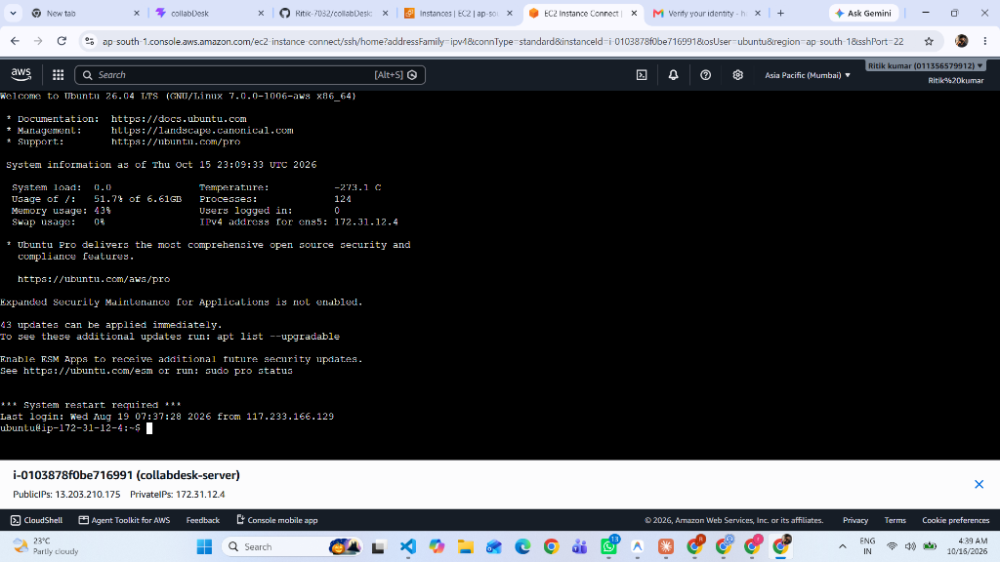
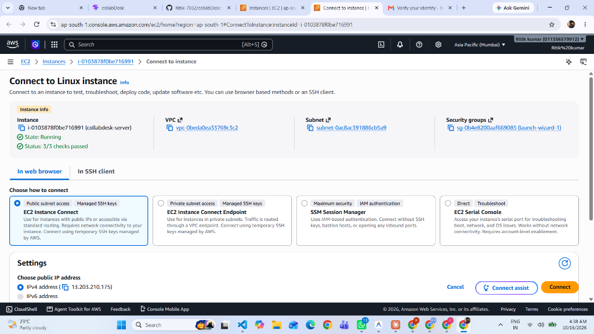
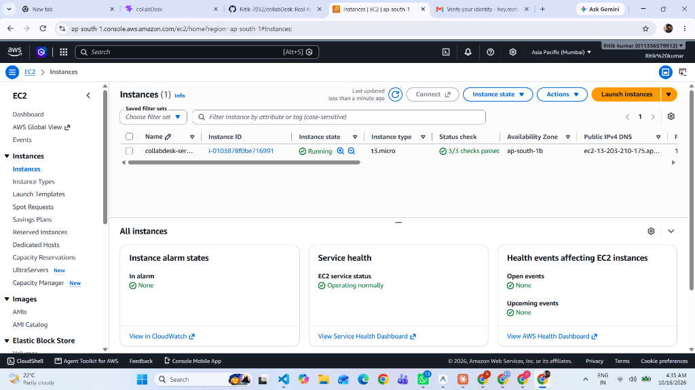
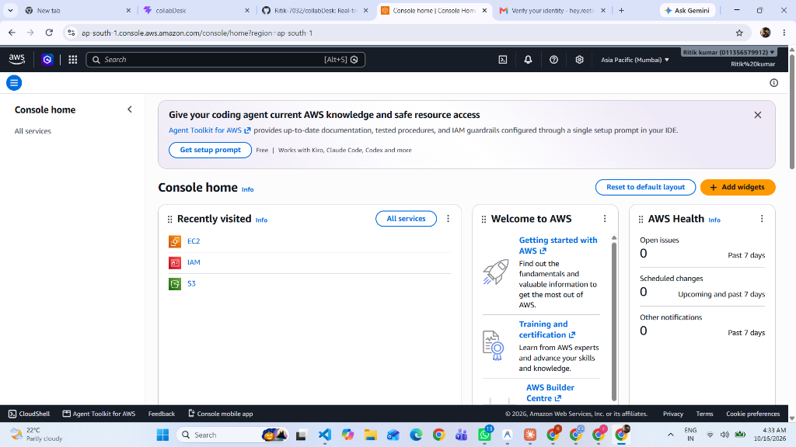
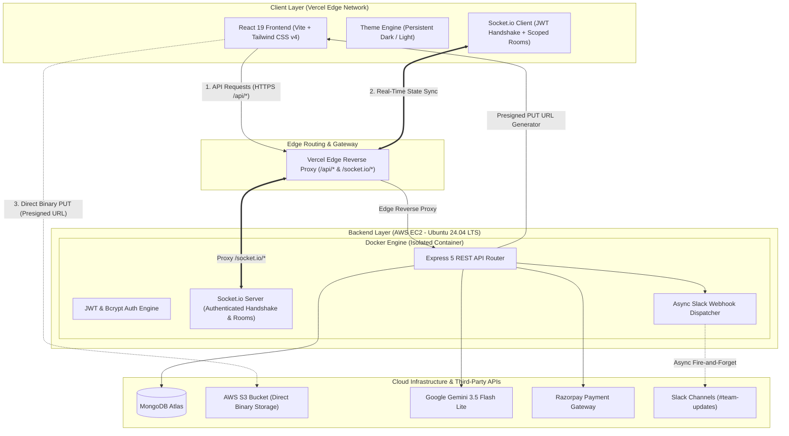

# 🚀 CollabDesk — Real-Time Collaborative Workspace & Kanban System

[](https://github.com/Ritik-7032/collabDesk/actions)
[](https://collab-desk-nine.vercel.app)
[](https://www.docker.com/)
[](https://aws.amazon.com/ec2/)
[](https://socket.io)
[](https://ai.google.dev)
[](https://nodejs.org)

CollabDesk is a distributed, full-stack collaborative Kanban workspace inspired by the design principles of Linear and Notion. Architected with a **React 19** frontend deployed on **Vercel's global edge network** and a containerized **Node.js / Express** backend running in **Docker on AWS EC2**, CollabDesk delivers real-time multi-user synchronization, automated task decomposition via Gemini AI, asynchronous Slack event alerting, and direct-to-cloud file streaming via AWS S3 presigned URLs.

---

## 📸 Product Overview & UI Showcase

| Linear-Grade Dark Mode (Default) | Task Detail Modal & AI Subtasks |
| :---: | :---: |
|  |  |

| Multi-Workspace Dashboard | Landing Page |
| :---: | :---: |
|  |  |

* **Live Deployment:** [https://collab-desk-nine.vercel.app](https://collab-desk-nine.vercel.app)
* **Real-time Demo:** Open two separate browser tabs side-by-side; dragging a card or creating a task in one window reflects instantaneously in the second window.

---

## 🏛️ System Architecture



---

## 🌟 Key Engineering Highlights

* **Multi-Workspace Real-Time Sync:** Real-time state synchronization via authenticated **Socket.io** rooms (`workspace:${workspaceId}`). Sockets authenticate via JWT handshakes, and room joins verify MongoDB workspace membership before granting subscription.
* **Optimistic UI with Automatic Rollback:** Drag-and-drop card transitions update local React state immediately for responsive interaction. If the batch mutation fails or the server rejects the request, the UI automatically rolls back to the previous snapshot with a toast alert.
* **Direct-to-S3 Presigned Uploads:** File attachments bypass application server memory buffers entirely. The backend validates file metadata (`fileSize <= 10MB` and MIME whitelist) and returns an AWS S3 presigned PUT URL with Content-Type signature locking.
* **Resilient Gemini AI Breakdown:** Powered by **Google Gemini 3.5 Flash Lite** (`gemini-3.5-flash-lite`) to decompose high-level task goals into structured checklist items. Features an internal fallback handler so that upstream API rate limits or 503 spikes never break user interactions.
* **Fire-and-Forget Slack Alerts:** Dispatches asynchronous Slack Block Kit notifications on task creation and column moves without blocking core HTTP request-response cycles.
* **Enterprise Security & Payments:** Google OAuth 2.0, JWT token management with Bcrypt password hashing, and server-side HMAC-SHA256 signature verification for Razorpay checkout transactions.
* **Automated CI/CD Test Pipeline:** 9 passing integration test suites executed via Supertest and GitHub Actions validating authentication, workspace authorization, S3 signature generation, and password reset flows.

---

## 🚀 Getting Started

### Prerequisites
* **Docker & Docker Compose** (Recommended for single-command launch) OR **Node.js v20+**
* MongoDB Atlas connection string
* AWS IAM credentials with S3 PutObject access
* Google Gemini API Key

---

### Method A: 🐳 Docker Compose (Recommended)

Run the entire backend in a single command with automatic container restarts:

```bash
# 1. Clone repository
git clone https://github.com/Ritik-7032/collabDesk.git
cd collabDesk

# 2. Configure backend environment
cp backend/.env.example backend/.env
# Edit backend/.env with your credentials

# 3. Build and launch container in background
docker compose up -d --build

# View container logs
docker compose logs -f
```

---

### Method B: 💻 Manual Local Development

#### 1. Backend Setup
```bash
cd backend
cp .env.example .env
npm install

# Run automated integration tests
npm test

# Start development server
npm run dev
```

#### 2. Frontend Setup
```bash
cd frontend
npm install

# Start Vite dev server with API proxy
npm run dev

# Build production bundle
npm run build
```

---

## 📡 REST API Reference

| Method | Endpoint | Description | Auth Required |
| :--- | :--- | :--- | :---: |
| `POST` | `/api/auth/signup` | Register new user account | ❌ No |
| `POST` | `/api/auth/login` | Login with credentials & receive JWT token | ❌ No |
| `POST` | `/api/auth/forgot-password` | Generate 15-minute cryptographic reset token | ❌ No |
| `POST` | `/api/auth/reset-password` | Reset password using valid token | ❌ No |
| `GET` | `/api/auth/me` | Fetch authenticated user profile | 🔒 Yes |
| `GET` | `/api/auth/google` | Initiate Google OAuth 2.0 flow | ❌ No |
| `POST` | `/api/workspaces` | Create workspace & seed default Kanban lists | 🔒 Yes |
| `GET` | `/api/workspaces` | Fetch all workspaces user belongs to | 🔒 Yes |
| `POST` | `/api/workspaces/:id/members` | Invite team member by email | 🔒 Yes |
| `DELETE` | `/api/workspaces/:id/members/:mId` | Remove member from workspace (Owner only) | 🔒 Yes |
| `PATCH` | `/api/workspaces/:id/slack-webhook` | Update Slack incoming webhook URL | 🔒 Yes |
| `POST` | `/api/workspaces/:id/slack-test` | Dispatch test ping to Slack channel | 🔒 Yes |
| `GET` | `/api/lists/workspace/:wsId` | Fetch ordered columns for a workspace | 🔒 Yes |
| `POST` | `/api/lists` | Create a new custom column | 🔒 Yes |
| `PUT` | `/api/lists/reorder` | Bulk reorder columns | 🔒 Yes |
| `GET` | `/api/tasks/workspace/:wsId` | Fetch all tasks for a workspace | 🔒 Yes |
| `POST` | `/api/tasks` | Create task (triggers Socket & Slack alert) | 🔒 Yes |
| `PUT` | `/api/tasks/:id` | Update task fields (checklist, assignee, priority) | 🔒 Yes |
| `PUT` | `/api/tasks/reorder/bulk` | Drag-and-drop batch position update | 🔒 Yes |
| `POST` | `/api/tasks/:id/comments` | Add threaded comment to card | 🔒 Yes |
| `POST` | `/api/upload/presign` | Generate direct S3 Presigned PUT URL | 🔒 Yes |
| `POST` | `/api/ai/generate-subtasks` | AI task decomposition via Gemini 3.5 | 🔒 Yes |
| `POST` | `/api/payment/create-order` | Create Razorpay order for lifetime Pro plan | 🔒 Yes |
| `POST` | `/api/payment/verify-payment` | Verify HMAC-SHA256 signature & upgrade plan | 🔒 Yes |

---

## 📊 Performance Benchmarks & Load Testing

CollabDesk includes an automated load testing harness using **Autocannon** and **k6** to measure throughput and latency distributions across real-world database and gateway workloads.

### Scenario A: Authenticated Database Read (`GET /api/tasks/workspace/:id`)
* **Workload:** 10 concurrent connections (simulating active sprint team) reading 20 populated task documents over MongoDB Atlas with JWT verification, workspace authorization, and compound B-Tree index scan (`{ workspace: 1, position: 1 }`).
* **Environment:** Client test runner connecting across public WAN to AWS `ap-south-1` MongoDB Atlas cluster.
* **Tool:** Autocannon (5s sustained run)

#### The WAN Latency Floor & Architectural Optimization
A naive un-cached read over public cloud infrastructure incurs **3 sequential network hops** per request:
1. `authMiddleware` verifies JWT and performs `User.findById` (RTT 1: ~50ms)
2. `workspaceAccess` queries `Workspace.exists` to verify membership (RTT 2: ~50ms)
3. `taskController` queries `Task.find` with population (RTT 3: ~50ms)

$$\text{Theoretical Latency Floor} = 3 \times 55\text{ms} \approx 165\text{ms} - 200\text{ms}$$

To eliminate redundant WAN round-trips for repeated sprint team queries, CollabDesk introduces **15-second TTL in-memory session and membership micro-caching** (`sessionCache` and `memberCache`) with immediate cache invalidation on member revocation (`invalidateMembershipCache`). This collapses subsequent queries from 3 network round-trips down to **1 single database hop**.

#### Measured Results: Before vs. After Micro-Caching Optimization

| Metric | Baseline (3 Sequential WAN Hops) | Optimized (1 Single WAN Hop) | Improvement |
| :--- | :--- | :--- | :--- |
| **Throughput** | 33.8 req/sec | **105.0 req/sec** | **+210% (3.1x)** |
| **Median Latency (p50)** | 202 ms | **64 ms** | **-68% latency** |
| **Average Latency** | 291.8 ms | **97.9 ms** | **-66% latency** |
| **97.5th Percentile (p97.5)**| 581 ms | **433 ms** | **-25% latency** |
| **Bandwidth** | 356 kB/sec | **1.11 MB/sec** | **+211%** |
| **Completed Requests** | 170 reqs / 5s | **500 reqs / 5s** | **+194%** |
| **HTTP Error Rate** | 0.00% (0 errors) | **0.00% (0 errors)** | **Rock Solid** |

---

### Scenario B: Gateway & Security Pipeline (`GET /`)
* **Workload:** 50 concurrent connections testing Express middleware chain (Helmet security headers, CORS origin validation, and nanosecond latency tracking via `process.hrtime.bigint`).

| Metric | Measured Value | Unit |
| :--- | :--- | :--- |
| **Throughput** | 9,282 | requests / second |
| **Bandwidth** | 9.1 | MB / second |
| **Median Latency (p50)** | 4.0 | ms |
| **97.5th Percentile (p97.5)** | 11.0 | ms |
| **99th Percentile (p99)** | 16.0 | ms |
| **Average Latency** | 4.92 | ms |
| **HTTP Error Rate** | 0.00% (0 errors / 46,000 total requests) | % |

```bash
# Reproduce the authenticated database benchmark locally:
cd backend && npm run benchmark

# Run the cross-instance Redis cluster verification:
npm run test:cluster

# Run k6 scenario:
k6 run tests/k6-load-test.js
```

---

## 🌐 Horizontal Scaling & Redis Pub/Sub Cluster

CollabDesk is architected for seamless horizontal scale across multiple Node.js instances behind a load balancer:

1. **Redis Pub/Sub Adapter (`@socket.io/redis-adapter`):**
   - When running multiple backend processes, socket connections distribute across instances.
   - Room events (`workspace:${id}`) emitted on Instance B automatically publish to Redis and fan out to sockets connected on Instance A.
2. **Multi-Instance Docker Compose Setup:**
   - `docker-compose.yml` orchestrates two backend replicas (`backend` on `:5000` and `backend-replica` on `:5001`) alongside a shared `redis:7-alpine` container (`:6379`).
   - If `REDIS_URL` is omitted, the server automatically falls back to single-node in-memory adapter without throwing errors.
3. **Cross-Instance RemoteSocket Eviction (`socket.data.user`):**
   - Socket.io's `io.in(room).fetchSockets()` returns `RemoteSocket` proxies for connections hosted on peer instances.
   - Custom properties set on `socket` (e.g. `socket.user`) are lost across process boundaries. CollabDesk sets `socket.data.user = decoded` during the handshake, ensuring member eviction (`s.leave(roomName)`) properly identifies and evicts revoked users across cluster nodes.
   - Fully automated and verified in `backend/tests/cross-instance-test.js` (`npm run test:cluster`).

## 🧠 Core Design Decisions & Engineering Tradeoffs

### 1. Direct S3 Presigned Uploads: Server Offloading vs. Size Enforcement
* **Tradeoff:** Streaming uploads through Express (`multer.memoryStorage`) buffers raw bytes directly in heap memory, risking event loop starvation or Out-Of-Memory (OOM) crashes under concurrent load. Conversely, presigned PUT URLs delegate binary transfer to AWS S3, but cannot inspect file bytes on the server during upload.
* **Solution:** CollabDesk implements server-side pre-validation (`fileSize <= 10MB` and MIME whitelist) before generating an AWS S3 presigned PUT URL with `ContentType` signature locking. Mismatched content types are rejected by S3. For hard byte-level size enforcement on S3 without server buffering, AWS S3 Presigned POST with a `content-length-range` policy condition represents the production next step.

### 2. Hybrid Real-Time Transport: WebSockets vs. HTTP Long-Polling
* **Tradeoff:** Vercel's serverless edge terminates SSL and provides global static caching, but does not support persistent TCP WebSocket upgrade handshakes (HTTP 101). Conversely, connecting directly to an HTTP backend IP triggers browser Mixed Content security blocks.
* **Solution:** CollabDesk routes Socket.io traffic through Vercel's Edge Reverse Proxy (`/socket.io/*`), utilizing HTTP long-polling securely over HTTPS with zero browser security blocks. For native full-duplex WebSockets (WSS), the architecture supports direct connection to an SSL-terminated host (e.g. Nginx on EC2).

### 3. WebSocket Security: JWT Handshake & Database Room Authorization
* **Tradeoff:** Unauthenticated socket connections allow eavesdropping, and naive `io.emit()` broadcasts leak internal task updates across different organizations.
* **Solution:** CollabDesk enforces a two-layer security barrier: incoming socket handshakes are strictly authenticated via JWT middleware (`io.use`), rejecting missing or invalid tokens at the handshake level. Furthermore, room access (`workspace:${id}`) verifies active MongoDB workspace membership before subscription, and member revocation dynamically evicts active sockets from the room.

### 4. Third-Party Resiliency: Slack Webhooks & Gemini AI Fallback
* **Tradeoff:** External APIs (Slack, Google Gemini) are subject to transient network latency, rate limits, and outages. Blocking core database transactions on external API acknowledgments degrades latency and creates single points of failure.
* **Solution:** Slack notifications dispatch asynchronously in a fire-and-forget pattern with isolated error handling. Similarly, the Gemini AI task decomposition controller includes an internal fallback handler so that upstream Google API 503 rate-limit spikes never crash the user experience or fail CI test suites.

> 📖 **Deep Dive:** For the complete in-depth analysis of all 7 architectural decisions, failure modes, and testing strategies, see [docs/DESIGN.md](docs/DESIGN.md).

---

## 📂 Project Structure

```
collabDesk/
├── .github/
│   └── workflows/
│       └── ci.yml             # GitHub Actions CI automated build & test pipeline
├── docs/
│   ├── DESIGN.md              # In-depth architectural tradeoffs & failure modes
│   └── screenshots/           # High-resolution production UI screenshots
│       ├── board-dark.png     # Linear-grade Kanban board in dark mode
│       ├── task-modal-ai.png  # Task modal with Gemini AI subtask generator
│       ├── dashboard.png      # Multi-workspace dashboard
│       └── landing.png        # Landing page with interactive mockups
├── backend/
│   ├── config/                # DB, Passport, Gemini, S3, Razorpay configurations
│   ├── controllers/           # Business logic (auth, workspace, task, list, AI, upload, payment)
│   ├── middleware/            # Helmet, JWT auth, workspaceAccess, rateLimiter & requestMetrics
│   ├── models/                # Mongoose schemas with compound B-Tree indexes & OCC versioning
│   ├── routes/                # Express REST API route definitions
│   ├── utils/                 # Asynchronous Slack notification service
│   ├── tests/                 # Supertest & Socket.io 16-suite integration test runner
│   ├── Dockerfile             # Production-grade Node.js 20 Alpine container
│   ├── .env.example           # Documented environment template
│   └── server.js              # Server entry point, JWT socket handshake & room authorization
│
├── frontend/
│   ├── src/
│   │   ├── components/        # Modals (Invite, Slack, Task), Kanban Columns & Cards
│   │   │   └── ui/            # Reusable atomic UI suite (Button, Card, Modal, Input, Badge, etc.)
│   │   ├── context/           # ThemeContext (Dark/Light), AuthContext, ToastContext
│   │   ├── lib/               # Dynamic Axios client, Socket.io client, color utilities
│   │   ├── pages/             # Landing, Dashboard, WorkspacePage, Auth pages
│   │   └── App.jsx            # Router and layout configuration
│   ├── vercel.json            # Edge reverse proxy rewrite configuration (/api/* & /socket.io/*)
│   └── vite.config.js
│
├── docker-compose.yml         # Container orchestration with auto-restart policies
└── README.md
```

---

## 📄 License
ISC License — Built for engineering portfolio and scalable production showcase.
